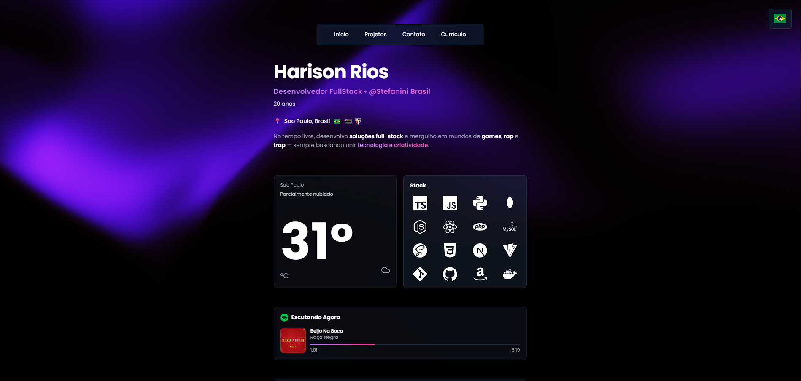

# Portfólio — Harison Rios 💻✨



Este é o repositório do meu portfólio pessoal. Nele, apresento alguns projetos, mostro as tecnologias usadas no site e deixo meus contatos. O conteúdo está disponível em português e inglês.

## 💻 Tecnologias utilizadas

<div align="center">
  
  <br />
</div>

O site também usa GSAP para animações e EmailJS no formulário de contato.

## 🚀 Projetos em destaque

- **PresenceDB** — aplicação web para acompanhar o tempo de jogo das atividades no Discord. Feita com Next.js, TypeScript e PostgreSQL.
- **VShop for Gaming** — app mobile para acompanhar a loja dos seus jogos favoritos. Feito com Expo e React Native Paper.
- **WoBahn** — mapa com a localização aproximada das linhas de metrô de Viena. Feito com Astro, MapLibre e Server-Sent Events (SSE).

## 📚 Instalação e uso

1. Clone o repositório:

   ```bash
   git clone https://github.com/HarisonRios/hari.dev.git
   ```

2. Entre na pasta e instale as dependências:

   ```bash
   cd hari.dev
   npm install
   ```

3. Inicie o servidor local:

   ```bash
   npm run dev
   ```

4. Acesse [http://localhost:3000](http://localhost:3000).

Para gerar e iniciar a versão de produção:

```bash
npm run build
npm start
```

## 🤝 Contato

- [LinkedIn](https://linkedin.com/in/harisonrios)
- [GitHub](https://github.com/HarisonRios)
- [E-mail](mailto:hharison562@gmail.com)

---
**Nota:** os projetos apresentados estão em desenvolvimento.
